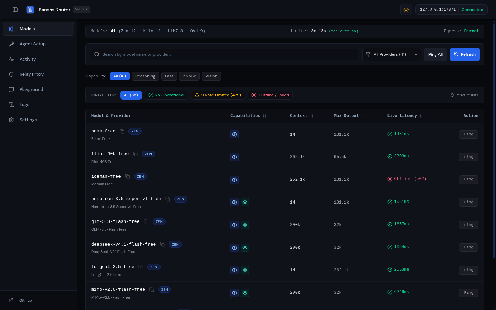

<div align="center">


# bansos-router

**Free, keyless coding models for every coding harness, through one local daemon.**<br>
No accounts, no API keys.


[](https://ihsan-ramadhan.github.io/bansos-router/)


</div>

<div align="center">



</div>

One daemon on `127.0.0.1:17070` that speaks OpenAI Chat Completions, Anthropic Messages and OpenAI Responses, so any harness can use the free tiers of OpenCode Zen, KiloCode, LLM7 and OVHcloud without signing up.

Free tiers rate-limit and rotate. A model that answers `401`/`403`/`429`/`5xx` is parked for a cooldown, and the request is retried on up to two other free models from a different upstream, picked to match the original reasoning mode, message-format capabilities and context window (never below 90% of it). Every request and its duration is logged.

## Quick start

```sh
npm i -g bansos-router   # install
bansos start --bg        # daemon on 127.0.0.1:17070
bansos setup opencode    # configure a harness, any id from below
```

Then open <http://127.0.0.1:17070> for the dashboard.

Check it works:

```sh
curl http://127.0.0.1:17070/v1/chat/completions \
  -H 'content-type: application/json' \
  -d '{"model":"deepseek-v4.1-flash-free","messages":[{"role":"user","content":"hi"}]}'
```

`bansos models` lists the catalog, `bansos ping` adds live latency, `bansos doctor` checks the whole setup.

## Harnesses

| How it wires up | Harnesses | What `bansos setup` writes |
| --- | --- | --- |
| Tiered | `claude-code` | Haiku, Sonnet and Opus mapped to the best matching free models |
| List | `opencode`, `goose`, `openclaw`, `continue` | every model registered, pick one in the app |
| Discovery | `9router`, `omp` | a provider that lists `/v1/models` itself |
| Single | `aider`, `codex`, `hermes`, `antigravity`, `jcode`, `cline`, `roo` | one smart default |

Pin the models you want with `--model <id>`, or narrow a set with `--models <id,...> --upstream <id,...>`; `--dry-run` prints the config and `--undo` reverts it. Per-harness details live in [docs/harnesses.md](docs/harnesses.md).

For [pi](https://github.com/earendil-works/pi), install the companion extension ([`extensions/pi`](extensions/pi/README.md)):

```sh
pi install npm:pi-bansos-router
```

**[OMP](https://github.com/can1357/oh-my-pi)** is a pi fork and works both ways; pick one:

```sh
bansos setup omp
```

writes a `bansos` provider into `~/.omp/agent/models.yml`, or:

```sh
omp plugin install pi-bansos-router
```

registers a `bansosr` provider and manages the daemon for you. The ids differ, so using both is harmless but redundant.

## Commands

| Command | Does |
| --- | --- |
| `start [--bg] [--port N] [--bind H]` | run the daemon, foreground or detached |
| `stop [--all]`, `restart` | control the daemon (`--all`: every daemon on the machine) |
| `status [--json]`, `logs [--activity]` | inspect it; `--activity` prints the structured request feed |
| `models [--json]`, `ping [model]` | catalog, and live latency of every model |
| `refresh`, `usage [--json]` | re-run health checks; token totals per model/upstream (full history) |
| `setup <harness...>` | write, update, dry-run or undo harness configs |
| `relay <on\|off\|status\|url\|use\|list\|remove>` | manage relay egress |
| `autostart <on\|off\|status> [--json]` | start the daemon at login (systemd, launchd, Startup folder) |
| `backup [file.json]`, `restore <file.json>` | export or restore config and usage history |
| `doctor` | diagnose daemon, relay, security, autostart, harness configs, updates |
| `--version`, `help <command>` | version and per-command help |

`bansosd` is an alias for the daemon (`bansosd --bg`).

## Configuration

Set variables in the environment; the dashboard's Settings tab edits the rest.

| Variable | Effect |
| --- | --- |
| `BANSOS_DIR` | state, config and logs instead of `~/.bansos` |
| `BANSOS_LOG=json` | JSON log lines instead of text |
| `BANSOS_RATE_LIMIT` | requests per minute per client IP (default 300) |
| `NO_UPDATE_NOTIFIER=1` | turn off the daily npm update check |

One knob lives outside the environment: `maxBodyBytes` caps an inbound request body (default 10 MB, clamped to 1 MB–256 MB) and takes a restart. Set it under Settings → Daemon, or as `"maxBodyBytes"` in `~/.bansos/config.json`, when a harness sends base64 screenshots or PDFs and the daemon answers `413`.

## Security

Local-only by default: CORS answers loopback origins only, the `Host` header is validated against DNS rebinding, and relay probes are SSRF-guarded (loopback, private and link-local targets are refused unless explicitly saved).

Strict mode is opt-in and fail-closed. Add a `security` block to `~/.bansos/config.json`:

```json
{
  "security": {
    "mode": "strict",
    "dlp": "redact",
    "allowedUpstreams": ["zen"],
    "allowCrossProviderFailover": false
  }
}
```

It restricts requests to the listed upstreams, disables relay egress and cross-provider failover, hides sensitive values and raw upstream errors in logs, and redacts credentials (API keys, PATs, private keys) in requests bound for an external upstream; `"dlp": "block"` rejects such requests with `422` instead. A non-loopback bind needs `--unsafe-allow-non-loopback`. The Settings tab applies the same switches live. Details: [docs/architecture.md](docs/architecture.md#6-security-model).

## Docker

```sh
docker build -t bansos-router .
docker run -d --name bansos -p 17070:17070 -v bansos-data:/home/node/.bansos bansos-router
```

Multi-stage build on `node:22-alpine` (~58 MB), state in the `bansos-data` volume, non-root `node` user, `tini` for signals and a `/healthz` healthcheck. `docker compose up -d` works too; `docker compose logs -f` replaces `bansos logs`.

## Troubleshooting

| Problem | Fix |
| --- | --- |
| `bansos: command not found` | `npm i -g bansos-router`, then reopen the shell |
| nothing answers on 17070 | `bansos status`, then `bansos doctor` |
| port already taken | the daemon auto-bumps over 17070-17090; set `--port N` to pin it |
| `403` from Zen | that model is parked for 30 minutes and the request fails over; send `x-bansos-no-failover: 1` to see the raw error |
| one model keeps returning `429` | `bansos ping <model>`, pick another free model, or let failover do it |
| harness sees no models | re-run `bansos setup <harness>` after `bansos refresh` |
| `413 request body too large` | raise the request body cap under Settings → Daemon, or `maxBodyBytes` in `~/.bansos/config.json` (up to 256 MB), then `bansos restart` |

## Endpoints

`GET /v1/models` · `POST /v1/chat/completions` · `POST /v1/responses` · `POST /v1/messages` · `GET /healthz`

Admin (dashboard, local only): `/bansos/status`, `/bansos/config`, `/bansos/adapters`, `/bansos/relay`, `/bansos/usage`, `/bansos/events`, `/bansos/autostart`, `/bansos/refresh`.

## Development

```sh
git clone https://github.com/ihsan-ramadhan/bansos-router
cd bansos-router
npm install
npm run build      # Web UI (Vite) + CLI (esbuild) into dist/
npm link
npm run typecheck
npm test
```

`npm run dev`, `dev:daemon` and `dev:ui` run pieces from source.

## Docs

[Architecture](docs/architecture.md) · [Wire protocols](docs/protocols.md) · [Harnesses](docs/harnesses.md) · [Upstreams, catalog & relay](docs/upstreams.md) · [Contributing](CONTRIBUTING.md) · [Model list](https://ihsan-ramadhan.github.io/bansos-router/)

## License

GPL-3.0-only. See [LICENSE](LICENSE).
